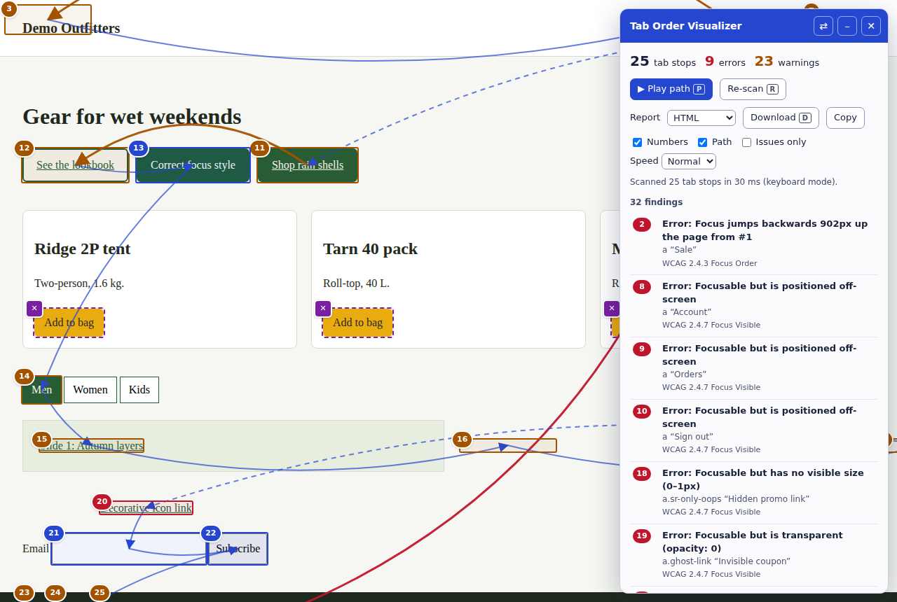

# Tab Order Visualizer

[](https://github.com/YOUR-USERNAME/tab-order-visualizer/actions/workflows/ci.yml)

See the keyboard path through any web page. Every element you can reach with <kbd>Tab</kbd> gets a numbered marker. Lines show where focus goes next, and the stops that break the path are flagged.



Automated scanners are good at finding missing labels. They are bad at telling you whether a person can actually get through the page with a keyboard. This tool doesn't try to answer that for you. It puts the path where you can see it, so you can judge it in seconds.

**Try it now:** [install the bookmarklet](https://YOUR-USERNAME.github.io/tab-order-visualizer/), then open the [broken demo store](https://YOUR-USERNAME.github.io/tab-order-visualizer/demo/broken-store.html) and the [fixed one](https://YOUR-USERNAME.github.io/tab-order-visualizer/demo/fixed-store.html). A 50-second demo video is attached to the [latest release](https://github.com/YOUR-USERNAME/tab-order-visualizer/releases/latest).

## What it flags

| Finding | Severity | WCAG |
|---|---|---|
| Focus jumps back up the page, or moves right-to-left within a row | Error / warning | 2.4.3 Focus Order |
| `tabindex` greater than 0 | Warning | 2.4.3 Focus Order |
| Focusable but invisible: 0–1px, `opacity: 0`, off-screen, clipped away | Error | 2.4.7 Focus Visible |
| Focusable but clipped by an `overflow: hidden` container (carousels, drawers) | Warning | 2.4.11 Focus Not Obscured |
| Focusable inside `aria-hidden="true"` | Error | 4.1.2 Name, Role, Value |
| Nothing visibly changes when the element is focused | Warning | 2.4.7 Focus Visible |
| Looks clickable (`onclick`, a widget `role`, or `cursor: pointer`) but can't be reached with Tab | Error / warning | 2.1.1 Keyboard |

Skip links that stay off-screen until focused are recognised as correct and aren't flagged.

## Install

**Bookmarklet (any Chromium browser, no install):** open the [install page](https://YOUR-USERNAME.github.io/tab-order-visualizer/) (or `dist/install.html` locally) and drag the button onto your bookmarks bar. Click it on any page to open, and click again to close.

**Chrome extension:** download `tab-order-visualizer-extension.zip` from the [latest release](https://github.com/YOUR-USERNAME/tab-order-visualizer/releases/latest) and unzip it, or use the `extension` folder from this repo.

1. Go to `chrome://extensions` and switch on **Developer mode**.
2. Click **Load unpacked** and choose the `extension` folder.
3. Click the toolbar icon or press <kbd>Alt</kbd>+<kbd>Shift</kbd>+<kbd>T</kbd>. To use it on local `file://` pages, turn on **Allow access to file URLs** in the extension's details.

The extension only asks for `activeTab` and `scripting`. It runs on the page you click it on and nowhere else, and it sends nothing anywhere.

## Using it

| Key | Action |
|---|---|
| <kbd>P</kbd> | Play the path: moves real focus through every stop, with a caption naming each one |
| <kbd>D</kbd> | Download the report in the chosen format |
| <kbd>R</kbd> | Re-scan (use after the page changes, or to re-check focus styles in keyboard mode) |
| <kbd>Esc</kbd> | Stop playback, or close the tool (inside a text field, Esc goes to the page, so a site's search still closes normally) |
| <kbd>Alt</kbd>+<kbd>Shift</kbd>+<kbd>P</kbd> / <kbd>R</kbd> | Play or re-scan while focus is in a search box or other text field |

Click any finding in the panel to scroll to that element.

**Reports:** choose a format and press **Download** (or <kbd>D</kbd>). Every report lists each finding with its WCAG criterion, accessible name and a CSS selector that locates the element, followed by the full tab order.

| Format | Best for |
|---|---|
| HTML | Reading, printing to PDF, or sending to people who don't use developer tools |
| CSV | Excel, Google Sheets, or bulk import into Jira and other trackers |
| Markdown | GitHub issues and pull requests |

**Copy** puts the Markdown version on your clipboard. Results are also in `window.__tabOrderVisualizer__.results` for scripting.

**Use the keyboard for P and R.** Many sites only draw focus outlines with `:focus-visible`, which the browser shows after keyboard use, not after a mouse click. If you start the tool with a click on such a page, the panel tells you to press R so the focus-style check runs in keyboard mode.

## How the order is worked out

The tool follows the HTML sequential-focus rules. It starts with natively focusable elements, contenteditable hosts and anything with a valid `tabindex`. It drops elements that are disabled, inert, `display: none` or `visibility: hidden`. Each radio group counts as one stop. Inside each focus scope (the document, or an open shadow root), positive `tabindex` values come first in ascending order, then everything else in DOM order. Shadow trees and slotted content are walked in flattened-tree order.

The test suite checks this against real <kbd>Tab</kbd> presses in Chromium on both demo pages. The two orders match stop for stop, including the shadow-DOM form and the `tabindex="1"` and `tabindex="3"` traps.

To test visibility and focus styles, the scan briefly focuses each element. It then puts focus and scroll positions back where they were.

## Limits

* Handlers added with `addEventListener` can't be seen from a page script, so the clickable check relies on `onclick`, ARIA roles and `cursor: pointer`. Expect a few misses.
* The focus-style check confirms that *something* changes. It doesn't judge whether the change has enough contrast or size; that part is your job.
* Closed shadow roots and cross-origin iframes are treated as single stops.
* The scan hides its test focus from the page's focus handlers, so search panels that open on focus and focus traps don't distort the results. One side effect: focus styles added by JavaScript (rather than CSS) aren't seen, and may be flagged as missing. Press P to watch what the page really does.
* The order shown is the whole page's. If a focus trap is active when you start (say, an open search panel), real Tab presses can't leave it. Close the panel first, then use P to watch how the trap behaves.

This is a testing aid, not a verdict. Every finding still needs a person with a keyboard to confirm it.

## Privacy and security

The tool collects nothing and sends nothing anywhere. It makes no network requests, doesn't touch cookies or browser storage, and leaves the page exactly as it found it when you close it. The extension can only run on a tab when you click its button. See the full [privacy policy](docs/privacy.md).

These guarantees are tested on every change. The test suite fails if the tool makes any network request, changes cookies or storage, or leaves anything behind on the page. It also loads a deliberately hostile page and checks that its text can't run code in the panel or in downloaded reports, and that CSV cells can't run as spreadsheet formulas.

Downloaded reports contain the scanned page's address and the text of the elements checked. Treat them like a screenshot of that page.

## Disclaimer

Tab Order Visualizer is a testing aid. Its automated checks show where to look; they don't prove a page is accessible or inaccessible. Results don't certify conformance with WCAG, the ADA, Section 508, the European Accessibility Act or any other standard or law, and they aren't legal advice. Confirm every finding with a keyboard, and with assistive technology where it matters. The software is provided "as is", without warranty of any kind, as set out in the [MIT License](LICENSE).

WCAG is a W3C standard; references to its success criteria are for identification only. This project isn't affiliated with or endorsed by W3C, Google or any company whose website it is used on. "Demo Outfitters" in the demo pages is fictional.

## Development

```bash
npm install
npx playwright install chromium   # once, for tests and the video
npm run build    # dist/ (bookmarklet, install page, Web Store zip), docs/ (Pages site), extension/tov.js
npm test         # end-to-end checks in real Chromium
```

### Demo video

The demo video is built from code, so it can be regenerated after any change to the tool:

```bash
PIPER=/path/to/piper VOICE=/path/to/en-us-libritts-high.onnx python3 video/make_voice.py   # narration
npm run record                                                                            # screen recording + timeline
python3 video/mix.py                                                                      # music, tab-stop ticks, captions
```

Each scene is stretched to fit its narration, every tab stop gets a soft tick (a lower tone on warnings and errors), and the music ducks under the voice. `video/mix.py` also writes `video/tab-order-visualizer-demo.srt` for captions. To narrate it in your own voice, record each line of `video/narration.json` as `video/audio/<id>.wav`, then run `OWN_VOICE=1 python3 video/make_voice.py` and the two steps after it. Voice and music credits are in [CREDITS.md](CREDITS.md).

The tests check three things. The computed order must match real Tab presses on both demo pages. Every planted bug in the broken store must be found. The fixed store must produce no findings. CI runs them on every push.

| Path | What's in it |
|---|---|
| `src/tov.js` | The whole tool: one dependency-free script |
| `extension/` | Manifest V3 extension (`activeTab` + `scripting` only) |
| `demo/broken-store.html` | Fictional shop with planted bugs: positive tabindex, a closed drawer with live links, a CSS `order` swap, clickable divs, an opacity-0 link, a clipped carousel, `aria-hidden` content |
| `demo/fixed-store.html` | The same shop with each bug fixed, plus correct patterns (skip link, roving-tabindex tabs, a web component, an `inert` carousel) |
| `tests/run.mjs` | End-to-end tests |
| `video/` | Title cards and the Playwright script that records the demo |
| `docs/` | GitHub Pages site, privacy page, Chrome Web Store listing copy |

## Licence

MIT © Ashok Kumar Yadav
